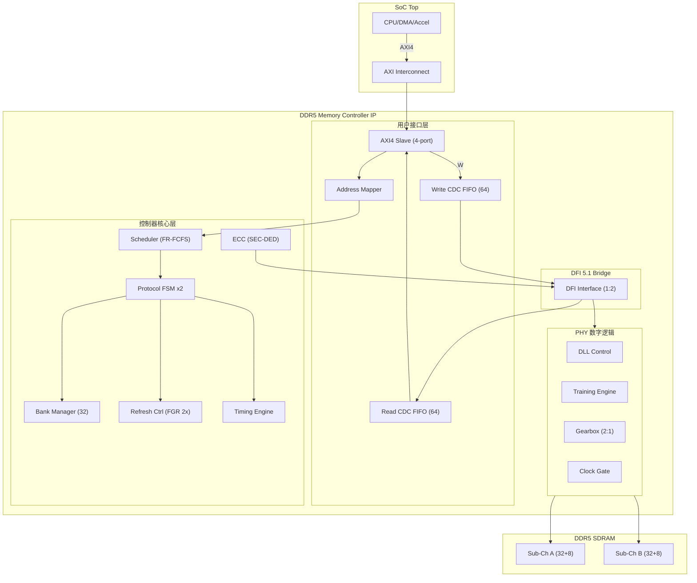

# DDR5 Memory Controller IP — RTL 开发规格书

**文档版本**: v2.0 (RTL-Ready)  
**协议基线**: JEDEC DDR5 (JESD79-5) + DFI 5.1  
**基线速率**: DDR5-4800 | **扩展**: DDR5-3200 ~ DDR5-6400  
**适用平台**: FPGA (Xilinx UltraScale+) / ASIC (TSMC 7nm/5nm)

---

## 1. IP 顶层架构

### 1.1 架构框图



### 1.2 模块层次

```
ddr5_controller (Top)
├── ddr5_ui_axi4           — AXI4 用户接口 (4-port)
│   ├── axi4_write_slave    — AW/W/B 通道
│   ├── axi4_read_slave     — AR/R 通道
│   ├── cmd_arbiter         — WRR+Priority 仲裁
│   ├── addr_mapper         — 地址映射 (Row-BG-Bank-Col)
│   └── cdc_fifo x3         — 指令/写数据/读数据 CDC
├── ddr5_ctrl_core          — 控制器核心
│   ├── cmd_scheduler       — FR-FCFS + BG Interleave (4级流水)
│   ├── protocol_fsm x2     — 协议状态机 (双子通道独立)
│   ├── bank_manager        — 32 Bank 状态管理
│   ├── refresh_ctrl        — FGR 2x/4x/REFab/REFsb/Self-Ref
│   ├── timing_engine       — 全参数倒计时引擎
│   └── ecc_engine          — SEC-DED 编解码 (Hsiao码)
├── ddr5_dfi_bridge         — DFI 5.1 桥接
├── ddr5_phy_digital        — PHY 数字逻辑
│   ├── dll_ctrl            — 数字 DLL (8-bit, 256步)
│   ├── training_engine     — 7步训练序列 FSM
│   ├── gearbox             — 256<->128 bit 位宽转换
│   └── clk_gate_ctrl       — 时钟门控
└── ddr5_cfg_apb            — APB 配置接口
```

---

## 2. 接口规格 (Interface Spec)

### 2.1 全局信号

| 信号名 | 方向 | 位宽 | 时钟域 | 复位值 | 说明 |
|--------|------|------|--------|--------|------|
| `user_clk` | Input | 1 | — | — | 用户时钟 200~400 MHz |
| `ctrl_clk` | Input | 1 | — | — | 控制器时钟 = DDR_CK/2 |
| `dfi_clk` | Input | 1 | — | — | DFI时钟 = DDR_CK/2 |
| `cfg_clk` | Input | 1 | — | — | 配置时钟 50~100 MHz |
| `por_rst_n` | Input | 1 | Global | 0 | 全局异步复位 (低有效) |
| `ui_rst_n` | Input | 1 | uclk | 0 | 用户接口复位 |
| `ctrl_rst_n` | Input | 1 | cclk | 0 | 控制器复位 |
| `phy_rst_n` | Input | 1 | pclk | 0 | PHY复位 |

### 2.2 AXI4 Slave 接口 (x4 Ports)

#### AW 写地址通道 (每端口)

| 信号名 | 方向 | 位宽 | 复位值 | 说明 |
|--------|------|------|--------|------|
| `s_axi_awid[P]` | Input | 8 | — | 写事务ID |
| `s_axi_awaddr[P]` | Input | 34 | — | 写地址 (最大16GB) |
| `s_axi_awlen[P]` | Input | 8 | — | 突发长度 (0~255) |
| `s_axi_awsize[P]` | Input | 3 | — | 突发大小 (2^n bytes) |
| `s_axi_awburst[P]` | Input | 2 | — | 01=INCR (仅支持INCR) |
| `s_axi_awlock[P]` | Input | 1 | — | **不支持**, 返回SLVERR |
| `s_axi_awcache[P]` | Input | 4 | — | 缓存属性 (透传) |
| `s_axi_awprot[P]` | Input | 3 | — | 保护类型 (透传) |
| `s_axi_awqos[P]` | Input | 4 | — | QoS优先级 (用于仲裁) |
| `s_axi_awvalid[P]` | Input | 1 | — | 地址有效 |
| `s_axi_awready[P]` | Output | 1 | 0 | 地址就绪 |

#### W 写数据通道 (每端口)

| 信号名 | 方向 | 位宽 | 复位值 | 说明 |
|--------|------|------|--------|------|
| `s_axi_wdata[P]` | Input | 256 | — | 写数据 |
| `s_axi_wstrb[P]` | Input | 32 | — | 字节选通 |
| `s_axi_wlast[P]` | Input | 1 | — | 突发最后一拍 |
| `s_axi_wvalid[P]` | Input | 1 | — | 数据有效 |
| `s_axi_wready[P]` | Output | 1 | 0 | 数据就绪 |

#### B 写响应通道 (每端口)

| 信号名 | 方向 | 位宽 | 复位值 | 说明 |
|--------|------|------|--------|------|
| `s_axi_bid[P]` | Output | 8 | 0 | 响应ID |
| `s_axi_bresp[P]` | Output | 2 | 0 | 00=OKAY, 10=SLVERR, 11=DECERR |
| `s_axi_bvalid[P]` | Output | 1 | 0 | 响应有效 |
| `s_axi_bready[P]` | Input | 1 | — | 响应就绪 |

#### AR 读地址通道 (每端口)

| 信号名 | 方向 | 位宽 | 复位值 | 说明 |
|--------|------|------|--------|------|
| `s_axi_arid[P]` | Input | 8 | — | 读事务ID |
| `s_axi_araddr[P]` | Input | 34 | — | 读地址 |
| `s_axi_arlen[P]` | Input | 8 | — | 突发长度 |
| `s_axi_arsize[P]` | Input | 3 | — | 突发大小 |
| `s_axi_arburst[P]` | Input | 2 | — | 01=INCR |
| `s_axi_arlock[P]` | Input | 1 | — | **不支持** |
| `s_axi_arcache[P]` | Input | 4 | — | 缓存属性 |
| `s_axi_arprot[P]` | Input | 3 | — | 保护类型 |
| `s_axi_arqos[P]` | Input | 4 | — | QoS优先级 |
| `s_axi_arvalid[P]` | Input | 1 | — | 地址有效 |
| `s_axi_arready[P]` | Output | 1 | 0 | 地址就绪 |

#### R 读数据通道 (每端口)

| 信号名 | 方向 | 位宽 | 复位值 | 说明 |
|--------|------|------|--------|------|
| `s_axi_rid[P]` | Output | 8 | 0 | 响应ID |
| `s_axi_rdata[P]` | Output | 256 | 0 | 读数据 |
| `s_axi_rresp[P]` | Output | 2 | 0 | 响应状态 |
| `s_axi_rlast[P]` | Output | 1 | 0 | 突发最后一拍 |
| `s_axi_rvalid[P]` | Output | 1 | 0 | 数据有效 |
| `s_axi_rready[P]` | Input | 1 | — | 数据就绪 |

### 2.3 APB 配置接口

| 信号名 | 方向 | 位宽 | 复位值 | 说明 |
|--------|------|------|--------|------|
| `paddr` | Input | 16 | — | APB地址 (64KB空间) |
| `pwdata` | Input | 32 | — | 写数据 |
| `prdata` | Output | 32 | 0 | 读数据 |
| `psel` | Input | 1 | — | 选择 |
| `penable` | Input | 1 | — | 使能 |
| `pwrite` | Input | 1 | — | 写使能 |
| `pready` | Output | 1 | 1 | 就绪 (无等待周期) |
| `pslverr` | Output | 1 | 0 | 从机错误 |

### 2.4 DFI 5.1 接口 (Controller <-> PHY)

| 信号名 | 方向 | 位宽 | 说明 |
|--------|------|------|------|
| `dfi_address` | Output | 18 | Row/Column地址 |
| `dfi_bank` | Output | 6 | BG[5:3]+BA[2:0] |
| `dfi_cs_n` | Output | 2 | 双子通道片选 |
| `dfi_act_n` | Output | 1 | Activate命令 |
| `dfi_ras_n` | Output | 1 | RAS |
| `dfi_cas_n` | Output | 1 | CAS |
| `dfi_we_n` | Output | 1 | WE |
| `dfi_cke` | Output | 2 | 时钟使能 |
| `dfi_odt` | Output | 2 | 片上终端 |
| `dfi_reset_n` | Output | 1 | DDR复位 |
| `dfi_wrdata` | Output | 128 | 64-bit x 2 子通道 |
| `dfi_wrdata_mask` | Output | 16 | 8-bit x 2 子通道 |
| `dfi_wrdata_en` | Output | 1 | 写数据使能 |
| `dfi_rddata` | Input | 128 | 64-bit x 2 子通道 |
| `dfi_rddata_valid` | Input | 1 | 读数据有效 |
| `dfi_init_complete` | Input | 1 | PHY初始化完成 |
| `dfi_train_complete` | Input | 1 | 训练完成 |
| `dfi_train_start` | Output | 1 | 启动训练 |
| `dfi_error` | Input | 8 | PHY错误状态 |

### 2.5 中断接口

| 信号名 | 方向 | 位宽 | 说明 |
|--------|------|------|------|
| `irq` | Output | 1 | 中断请求 (高有效) |

**中断源定义**:

| Bit | 名称 | 说明 |
|-----|------|------|
| 0 | ECC_SBE | ECC单比特纠错 |
| 1 | ECC_DBE | ECC双比特检错 (不可纠) |
| 2 | CRC_ERR | CRC校验错误 |
| 3 | TRAIN_DONE | 训练完成 |
| 4 | TRAIN_ERR | 训练失败 |
| 5 | REF_OVF | 刷新溢出 (credit=8) |
| 6 | TEMP_ALERT | 温度告警 |
| 7 | ILLEGAL_CMD | 非法命令检测 |
| 8 | DFI_ERR | DFI接口错误 |
| 9 | PHY_ERR | PHY错误 |
| 10~31 | — | 保留 |

---

## 3. 寄存器映射表 (Register Map)

**基地址**: 0x0000 | **空间**: 64KB (16-bit APB地址) | **数据宽度**: 32-bit

### 3.1 全局控制 (0x0000~0x00FF)

| 偏移 | 名称 | R/W | 复位值 | 位域定义 |
|------|------|-----|--------|----------|
| 0x0000 | CTRL | R/W | 0x0000_0000 | [0] enable, [1] soft_reset, [2] low_power, [3] self_refresh, [4] train_start, [7:5] reserved, [9:8] data_rate(00=3200,01=4800,10=5600,11=6400), [11:10] refresh_mode(00=1x,01=2x,10=4x), [12] ecc_en, [13] crc_en, [15:14] scheduler_alg(00=FR-FCFS,01=PAR-BS), [31:16] reserved |
| 0x0004 | STATUS | RO | 0x0000_0000 | [0] ready, [1] train_complete, [2] train_error, [3] sr_active, [4] lp_active, [7:5] fsm_state, [9:8] cur_rate, [11:10] cur_ref_mode, [31:12] reserved |
| 0x0008 | VERSION | RO | 0x0001_0000 | [31:16] major, [15:0] minor |
| 0x000C | CAPABILITY | RO | synth-dep | [0] ecc_sup, [1] crc_sup, [2] multi_rank, [3] dual_ch, [7:4] max_ranks, [11:8] max_rate, [15:12] data_width |

### 3.2 时序参数 (0x0100~0x01FF) — 单位: tCK

| 偏移 | 名称 | R/W | DDR5-4800默认 | 位域 |
|------|------|-----|---------------|------|
| 0x0100 | TIMING_0 | R/W | 0x0022_0022 | [15:0] tRCD=34, [31:16] tRP=34 |
| 0x0104 | TIMING_1 | R/W | 0x006F_004D | [15:0] tRAS=77, [31:16] tRC=111 |
| 0x0108 | TIMING_2 | R/W | 0x0180_02C5 | [15:0] tRFC=709, [31:16] tRFCsb=384 |
| 0x010C | TIMING_3 | R/W | 0x0028_249F | [15:0] tREFI=9375, [31:16] tWR=72 |
| 0x0110 | TIMING_4 | R/W | 0x0028_0012 | [15:0] tRTP=18, [31:16] CL=40 |
| 0x0114 | TIMING_5 | R/W | 0x0008_0027 | [15:0] CWL=39, [31:16] tCCD_L=8 |
| 0x0118 | TIMING_6 | R/W | 0x0004_0008 | [15:0] tCCD_S=4, [31:16] tRRD_L=8 |
| 0x011C | TIMING_7 | R/W | 0x0004_0010 | [15:0] tRRD_S=4, [31:16] tFAW=16 |
| 0x0120 | TIMING_8 | R/W | 0x000A_000A | [15:0] tXS=10, [31:16] tXP=10 |
| 0x0124 | TIMING_9 | R/W | 0x0008_0008 | [15:0] tZQCAL=8, [31:16] tZQCS=8 |

### 3.3 刷新控制 (0x0200~0x02FF)

| 偏移 | 名称 | R/W | 复位值 | 位域 |
|------|------|-----|--------|------|
| 0x0200 | REFRESH_CTRL | R/W | 0x0000_0001 | [0] auto_ref_en, [1] manual_trigger, [3:2] mode(00=1x,01=2x,10=4x), [4] same_bank_en, [15:8] credit_threshold(默认8), [31:16] reserved |
| 0x0204 | REFRESH_STATUS | RO | 0x0000_0000 | [7:0] credit_count, [15:8] pending_count, [16] in_progress, [17] overflow, [31:18] reserved |
| 0x0208 | REFRESH_COUNT | RO | 0x0000_0000 | [31:0] total_count (读清零) |

### 3.4 ECC 控制 (0x0300~0x03FF)

| 偏移 | 名称 | R/W | 复位值 | 位域 |
|------|------|-----|--------|------|
| 0x0300 | ECC_CTRL | R/W | 0x0000_0001 | [0] enable, [1] error_inject_en, [3:2] inject_bit_pos, [31:4] reserved |
| 0x0304 | ECC_STATUS | RO | 0x0000_0000 | [0] sbe_detected(sticky), [1] dbe_detected(sticky), [2] overflow, [31:3] reserved |
| 0x0308 | ECC_ERR_ADDR | RO | 0x0000_0000 | [31:0] last_error_address |
| 0x030C | ECC_ERR_DATA | RO | 0x0000_0000 | [31:0] last_error_data (纠错前) |
| 0x0310 | ECC_ERR_SYNDROME | RO | 0x0000_0000 | [31:0] last_error_syndrome |
| 0x0314 | ECC_SBE_COUNT | RO | 0x0000_0000 | [31:0] sbe_count (读清零) |
| 0x0318 | ECC_DBE_COUNT | RO | 0x0000_0000 | [31:0] dbe_count (读清零) |

### 3.5 训练控制 (0x0400~0x04FF)

| 偏移 | 名称 | R/W | 复位值 | 位域 |
|------|------|-----|--------|------|
| 0x0400 | TRAIN_CTRL | R/W | 0x0000_0000 | [0] start, [1] abort, [7:2] step_select(0=all,1=CA,2=WL,3=RGT,4=RDQ,5=WDQ,6=Vref,7=DFE), [31:16] timeout_ms(默认100) |
| 0x0404 | TRAIN_STATUS | RO | 0x0000_0000 | [0] in_progress, [1] complete, [2] error, [7:3] cur_step, [15:8] error_code, [31:16] reserved |
| 0x0408 | TRAIN_PROGRESS | RO | 0x0000_0000 | [7:0] progress_percent(0~100), [31:8] reserved |

### 3.6 训练结果 (0x0500~0x06FF)

| 偏移 | 名称 | R/W | 说明 |
|------|------|-----|------|
| 0x0500 | CA_DELAY | RO | [7:0] CA训练结果 (最优延迟码) |
| 0x0504~0x0520 | WL_DELAY[0:7] | RO | 每字节通道Write Leveling延迟 (x8) |
| 0x0524~0x0540 | RGT_DELAY[0:7] | RO | 每字节通道Read Gate延迟 (x8) |
| 0x0544~0x05C0 | RDQ_DELAY[0:31] | RO | 每bit读DQ延迟 (x32) |
| 0x05C4~0x0640 | WDQ_DELAY[0:31] | RO | 每bit写DQ延迟 (x32) |
| 0x0644 | VREF_CODE | RO | [6:0] Vref训练结果 |
| 0x0648~0x0654 | DFE_TAP[0:3] | RO | DFE抽头系数 (x4) |

### 3.7 性能计数器 (0x0700~0x07FF)

| 偏移 | 名称 | R/W | 说明 |
|------|------|-----|------|
| 0x0700 | PERF_CTRL | R/W | [0] enable, [1] clear_all, [31:2] reserved |
| 0x0704 | READ_COUNT | RO | [31:0] 总读命令数 (读清零) |
| 0x0708 | WRITE_COUNT | RO | [31:0] 总写命令数 (读清零) |
| 0x070C | ACT_COUNT | RO | [31:0] 总Activate命令数 (读清零) |
| 0x0710 | PRE_COUNT | RO | [31:0] 总Precharge命令数 (读清零) |
| 0x0714 | REF_COUNT | RO | [31:0] 总Refresh命令数 (读清零) |
| 0x0718 | PAGE_HIT_COUNT | RO | [31:0] 页命中次数 (读清零) |
| 0x071C | PAGE_MISS_COUNT | RO | [31:0] 页缺失次数 (读清零) |
| 0x0720 | PAGE_CONFLICT_COUNT | RO | [31:0] 页冲突次数 (读清零) |
| 0x0724 | IDLE_CYCLE_COUNT | RO | [31:0] 空闲周期数 (读清零) |
| 0x0728 | BUSY_CYCLE_COUNT | RO | [31:0] 忙周期数 (读清零) |

### 3.8 中断控制 (0x0800~0x08FF)

| 偏移 | 名称 | R/W | 复位值 | 位域 |
|------|------|-----|--------|------|
| 0x0800 | IRQ_STATUS | R/W1C | 0x0000_0000 | [9:0] 中断源状态 (写1清零), [31:10] reserved |
| 0x0804 | IRQ_ENABLE | R/W | 0x0000_0000 | [9:0] 中断使能掩码 (1=enable), [31:10] reserved |
| 0x0808 | IRQ_RAW | RO | 0x0000_0000 | [9:0] 原始中断状态 (未屏蔽) |

### 3.9 调试寄存器 (0x0900~0x09FF)

| 偏移 | 名称 | R/W | 复位值 | 位域 |
|------|------|-----|--------|------|
| 0x0900 | DEBUG_CTRL | R/W | 0x0000_0000 | [0] force_page_conflict, [1] force_refresh, [2] disable_scheduler, [3] single_step_mode, [31:4] reserved |
| 0x0904 | FSM_TRACE | RO | — | FSM状态追踪缓冲区 (循环覆盖) |
| 0x0908 | CMD_TRACE | RO | — | 命令追踪缓冲区 (循环覆盖) |

---

## 4. 时钟域与电源域约束

### 4.1 时钟域划分

| 时钟域 | 名称 | 频率 (DDR5-4800) | 频率 (DDR5-6400) | 来源 | 负载模块 |
|--------|------|-----------------|-----------------|------|----------|
| uclk | User Clock | 400 MHz | 400 MHz | 外部或PLL分频 | AXI4接口, 配置寄存器 |
| cclk | Controller Clock | 600 MHz | 800 MHz | DDR_CK/4 | FSM, Scheduler, Bank Mgr, Refresh, Timing Engine, ECC |
| dfi_clk | DFI Clock | 1200 MHz | 1600 MHz | DDR_CK/2 | DFI Bridge, Gearbox |
| pclk | PHY Clock | 2400 MHz | 3200 MHz | DDR_CK (PHY内部) | DLL, I/O FF, Training采样 |
| cfg_clk | Config Clock | 50~100 MHz | 50~100 MHz | 外部 | APB接口 |

### 4.2 时钟频率关系

```
DDR5-4800:
  ref_clk (100MHz) --PLL x24--> ddr_ck (2400MHz)
    ddr_ck /2 --> dfi_clk (1200MHz)
    ddr_ck /4 --> cclk (600MHz)
    ref_clk x4  --> uclk (400MHz) 或外部提供

DDR5-6400:
  ref_clk (100MHz) --PLL x32--> ddr_ck (3200MHz)
    ddr_ck /2 --> dfi_clk (1600MHz)
    ddr_ck /4 --> cclk (800MHz)
    ref_clk x4  --> uclk (400MHz) 或外部提供
```

### 4.3 电源域划分 (ASIC)

| 电源域 | 电压 | 可关断 | 包含模块 |
|--------|------|--------|----------|
| PD_AON | 0.75V | 否 | 复位控制器, 唤醒逻辑, retention寄存器 |
| PD_Controller | 0.75V | 是 | 控制器核心, Scheduler, FSM, ECC |
| PD_PHY_Digital | 0.75V | 是 | PHY数字逻辑, DLL, Training, Gearbox |
| PD_PHY_Analog | 1.1V VDDQ | 否 | I/O驱动, 接收器, PLL, 模拟DLL (PHY vendor提供) |

**外部DDR5电源轨**:
- VDD: 1.1V (core)
- VDDQ: 1.1V (I/O)
- VPP: 1.8V (wordline pump)
- PMIC: On-DIMM电源管理 (DDR5独有)

### 4.4 低功耗模式

| 模式 | 描述 | 进入延迟 | 退出延迟 | 功耗节省 |
|------|------|---------|---------|----------|
| Clock Gating | 门控空闲时钟 | 即时 | 5~10 cycles | ~30% |
| Power Down (PD) | CKE=0, DLL off | 10 cycles | tXP (~6ns) | ~50% |
| Self-Refresh (SR) | CKE=0, 内部刷新 | 100 cycles | tXS (~300ns) | ~80% |

---

## 5. 复位架构

### 5.1 复位信号表

| 信号 | 时钟域 | 类型 | 说明 |
|------|--------|------|------|
| por_rst_n | Global | 异步 | 上电复位 (低有效) |
| ctrl_rst_n | cclk | 同步 | 控制器逻辑复位 |
| ui_rst_n | uclk | 同步 | 用户接口复位 |
| phy_rst_n | pclk | 同步 | PHY数字复位 |
| train_rst_n | pclk | 同步 | 训练引擎复位 |
| cfg_rst_n | cfg_clk | 同步 | 配置寄存器复位 |
| ddr_reset_n | External | 异步 | DDR5器件RESET_n引脚 |

### 5.2 复位同步策略

所有复位信号采用 **异步置位、同步释放** (Async Assert, Sync Deassert):

```
复位同步器 (每个时钟域一个):
  por_rst_n (async) --> FF1(async preset, sync clear) --> FF2(sync clear) --> domain_rst_n
```

### 5.3 复位释放序列

```
时间轴:  0       100us     200us     2.2ms     2.3ms     ~62ms
         |        |         |         |         |         |
por_rst_n:  ──────┘
ctrl_rst_n: ──────────┘
ddr_reset_n: ───────┘────┘
phy_rst_n:  ──────────────────┘
train_rst_n: ────────────────────┘
FSM状态:    RESET─────────INIT──────────IDLE
训练:       ──────────────────────CA─WL─RGT─RDQ─WDQ─Vref─DFE─DONE
```

**序列步骤**:
1. por_rst_n释放 (外部)
2. 2个周期后: 所有同步复位释放
3. FSM进入RESET状态
4. 等待100us (DDR5器件电源稳定)
5. 拉低ddr_reset_n 100us (DDR5规范要求)
6. 释放ddr_reset_n, 等待2ms
7. FSM转入INIT状态
8. 写入Mode Register (MR0~MR7, MR31)
9. 等待PLL锁定 (100us)
10. 释放PHY复位
11. 启动训练序列 (~60ms)
12. 训练完成 -> FSM转入IDLE
13. IP就绪, 可接受AXI事务
