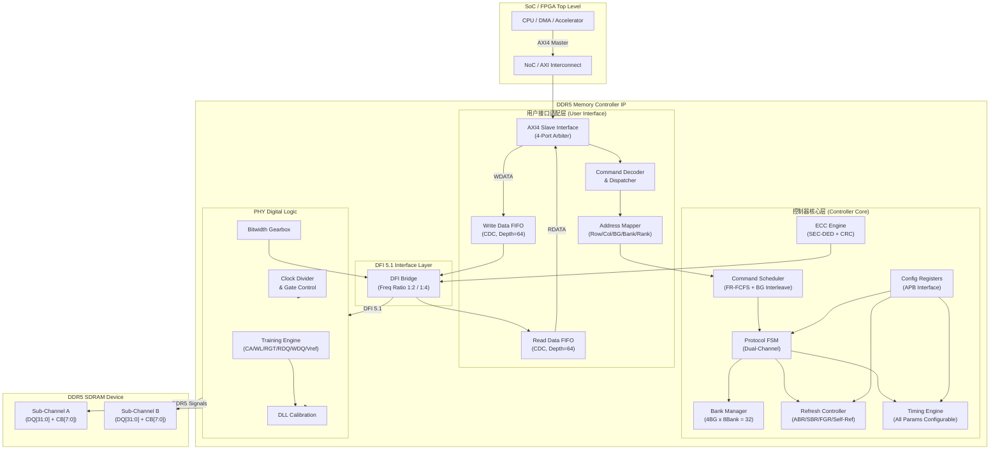
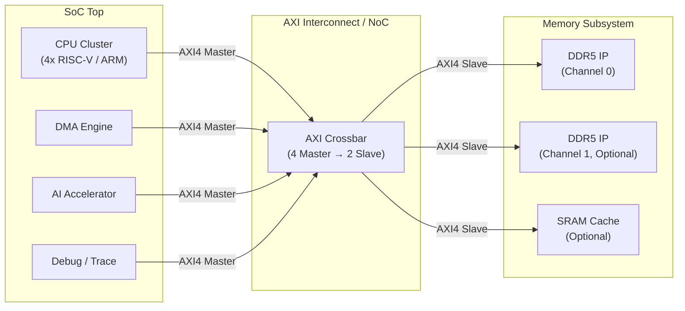
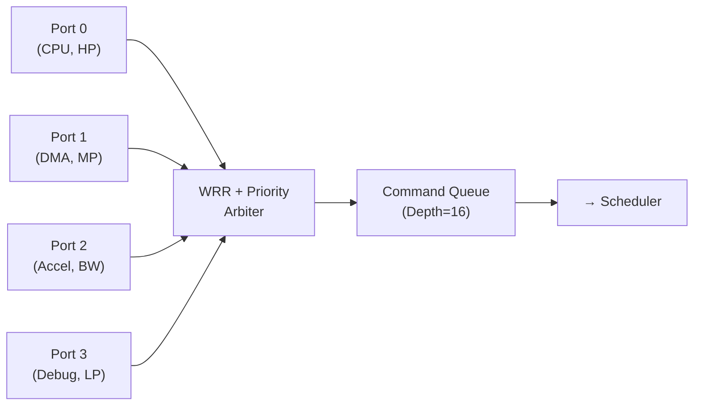

# DDR5 Memory Controller IP — 架构设计规格书 (Part 1: 总览与顶层架构)

> **文档版本**: v1.0 | **协议基线**: JEDEC DDR5 (JESD79-5) + DFI 5.1  
> **适用平台**: FPGA 原型验证 / ASIC SoC 集成

---

## 1. 设计目标与约束总览

### 1.1 设计目标

| 维度 | 目标 | 说明 |
|------|------|------|
| **协议** | JEDEC DDR5 (JESD79-5) | 支持 DDR5 SDRAM 全部核心命令集 |
| **速率** | DDR5-3200 ~ DDR5-6400 | 参数化可配置，基线 DDR5-4800 |
| **通道** | 双独立子通道 (Sub-Channel A/B) | 每子通道 32-bit 数据 + 8-bit ECC |
| **带宽利用率** | ≥ 85% (稳态连续读写) | FR-FCFS + Bank Group 交错调度 |
| **时序裕量** | Setup/Hold ≥ 10% tCK | 全 PVT corner 覆盖 |
| **刷新开销** | ≤ 5% 总线时间 | Fine Granularity Refresh 模式 |

### 1.2 约束条件

| 约束类型 | FPGA 原型 | ASIC 流片 |
|----------|-----------|-----------|
| 工艺 | Xilinx 7-Series / UltraScale+ | TSMC 7nm / 5nm |
| 面积预算 | ≤ 15K LUTs (控制器，不含 PHY) | ≤ 2.0 mm² (控制器 @7nm) |
| 功耗预算 | 控制器空闲 ≤ 总功耗 5% | 控制器 ≤ 50mW @1GHz |
| PHY 来源 | FPGA 硬核 (MIG) 或第三方软核 | Synopsys/Cadence PHY 宏单元 |
| EDA 工具 | Vivado 2025.2 | Design Compiler + ICC2 |

### 1.3 DDR5 vs DDR4 关键差异 (设计影响)

| 特性 | DDR4 | DDR5 (本设计) | 设计影响 |
|------|------|--------------|---------|
| 通道架构 | 单 72-bit | **双独立 32+8 bit 子通道** | 控制器需双通道独立 FSM |
| Bank 结构 | 16 banks (2BG×8) | **32 banks (4BG×8)** | Bank 管理规模翻倍 |
| 突发长度 | BL8 | **BL16** (默认) | 数据通路位宽翻倍 |
| DFE | 无 | **Decision Feedback Equalization** | PHY 需支持 DFE 训练 |
| On-die ECC | 无 | **内置 ECC** | 控制器需透明支持 |
| CA Training | 无 | **Command/Address Training** | 训练引擎新增步骤 |
| 数据速率 | ≤ 3200 Mbps | **3200~6400 Mbps** | 时序约束更严格 |
| 电源 | 单 VDD | **双电源 VDD/VDDQ + PMIC** | 电源序列控制更复杂 |

---

## 2. IP 顶层架构划分

### 2.1 顶层架构框图



### 2.2 模块层次关系

```
DDR5_IP (Top)
├── ddr5_ui_axi4          — AXI4 Slave 用户接口
│   ├── axi4_write_slave   — 写通道接收
│   ├── axi4_read_slave    — 读通道接收
│   ├── cmd_arbiter        — 多端口指令仲裁 (WRR+Priority)
│   └── cdc_fifo           — 跨时钟域 FIFO (Gray码指针)
├── ddr5_ctrl_core         — 控制器核心
│   ├── cmd_scheduler      — 指令调度器 (FR-FCFS + BG Interleave)
│   ├── protocol_fsm       — 协议状态机 (双通道独立FSM)
│   ├── bank_manager       — Bank 状态管理 (32 Banks)
│   ├── refresh_ctrl       — 刷新控制 (ABR/SBR/FGR/Self-Ref)
│   ├── timing_engine      — 时序参数引擎 (全参数可配)
│   └── ecc_engine         — ECC 引擎 (SEC-DED + CRC)
├── ddr5_dfi_bridge        — DFI 5.1 桥接层
├── ddr5_phy_digital       — PHY 数字逻辑
│   ├── dll_ctrl           — DLL 控制 (数字延迟链)
│   ├── training_engine    — 训练引擎 (CA/WL/RGT/RDQ/WDQ/Vref)
│   ├── gearbox            — 位宽转换 (Gearbox)
│   └── clk_gate_ctrl      — 时钟门控
└── ddr5_cfg_apb           — APB 配置接口
```

### 2.3 SoC 集成拓扑



---

## 3. 用户接口适配模块设计

### 3.1 AXI4 Slave 接口规格

| AXI4 通道 | 位宽 | 说明 |
|-----------|------|------|
| AW (写地址) | ADDR=34bit, ID=8bit, LEN=8bit, BURST=INCR | 支持突发写 |
| W (写数据) | DATA=256bit, STRB=32byte | 256-bit 宽数据通路 |
| B (写响应) | RESP=OKAY/DECERR/SLVERR | 写完成响应 |
| AR (读地址) | ADDR=34bit, ID=8bit, LEN=8bit, BURST=INCR | 支持突发读 |
| R (读数据) | DATA=256bit, RESP=OKAY/DECERR/SLVERR | 256-bit 宽数据通路 |

> **设计决策 — 用户侧数据位宽 256-bit**：
> - DDR5 BL16 × 32-bit = 512-bit/burst/sub-channel；双子通道合计 1024-bit/burst
> - 256-bit @ 400MHz → 12.8 GB/s/port；4端口聚合可达 51.2 GB/s (超过 DDR5-4800 理论带宽)
> - 与 AXI4 标准 256-bit 数据通路对齐，生态兼容性好

### 3.2 多端口仲裁策略



| 端口 | 角色 | 仲裁策略 | 权重 | QoS 保障 |
|------|------|---------|------|---------|
| Port 0 | CPU Core | Strict Priority | 最高 | 读延迟 ≤ 100ns |
| Port 1 | DMA | WRR | 4 | 带宽 ≥ 8 GB/s |
| Port 2 | Accelerator | WRR | 8 | 带宽 ≥ 16 GB/s |
| Port 3 | Debug/Trace | WRR | 1 | Best-effort |

### 3.3 地址映射方案

```
用户线性地址 [33:0] (34-bit, 最大 16GB)
┌───────────────────────────────────────────────────┐
│ [33:30] Rank         (4 bit, max 16 Ranks)         │
│ [29:17] Row          (13 bit, max 8192 rows/bank)  │
│ [16:14] Bank Group   (3 bit, 8 Bank Groups)        │
│ [13:11] Bank         (3 bit, 8 Banks/Group)        │
│ [10:6]  Column       (5 bit, BL16 aligned)         │
│ [5:0]   Byte Offset  (6 bit, 64-byte cache line)   │
└───────────────────────────────────────────────────┘

可配置映射模式:
  Mode 0: Row-BG-Bank-Col (默认, 优化 Bank 交错)
  Mode 1: BG-Row-Bank-Col (优化 Row 命中)
  Mode 2: 自定义 (寄存器位域重排)
```

> **设计决策 — 默认 Row-BG-Bank-Col**：
> - 连续地址分布在同 Row 不同 Bank/Bank Group 上
> - 最大化 Bank Interleave，跨 BG 用 tCCD_S 短延迟
> - 避免同 BG 内 tCCD_L 长延迟惩罚

### 3.4 跨时钟域 FIFO 设计

| FIFO | 深度 | 位宽 | 同步策略 |
|------|------|------|---------|
| 写数据 (uclk→cclk) | 64 | 256-bit + 32B strobe | 异步 FIFO, Gray码指针 |
| 读数据 (cclk→uclk) | 64 | 256-bit + resp | 异步 FIFO, Gray码指针 |
| 指令 (uclk→cclk) | 16 | 64-bit (cmd+addr+id) | 异步 FIFO, Gray码指针 |

**FIFO 深度计算**:
```
写 FIFO: max AXI burst = 256 beats × (256/256) = 256 entries
         实际取 64 entries (AXI LEN max=255, 但实际 burst 通常 ≤64)
         含 2x 安全裕量 → 64 entries

读 FIFO: 同上 = 64 entries

指令 FIFO: 调度器流水线深度 × 2 = 8 × 2 = 16 entries
```
