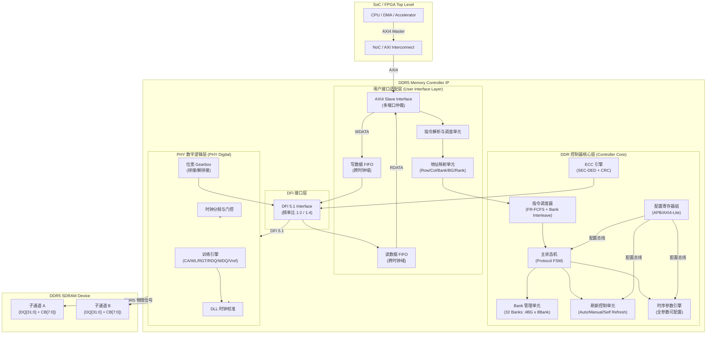
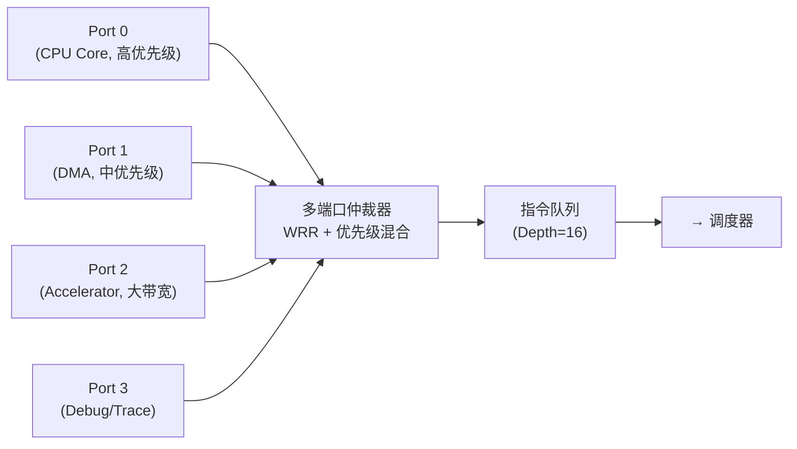
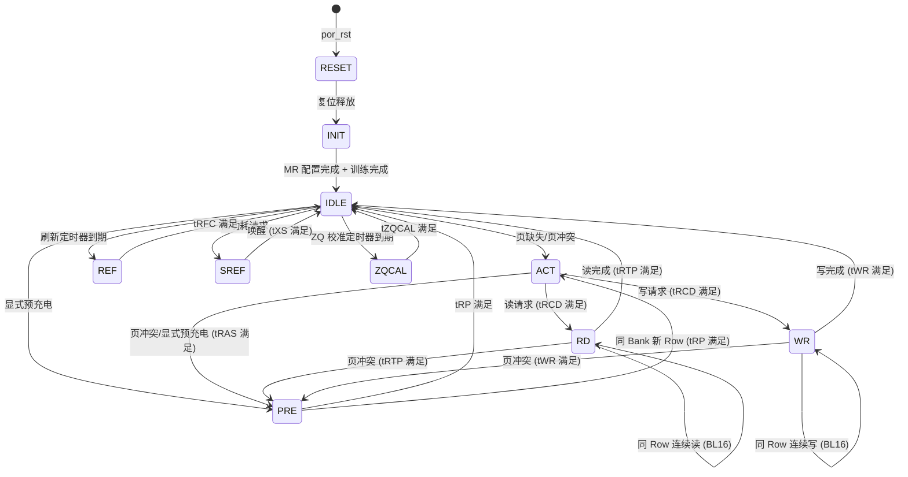

# DDR5 Memory Controller IP — 架构设计规格书

> **文档版本**: v1.0  
> **文档状态**: 架构方案设计（Phase 2 产出物）  
> **适用平台**: FPGA 原型验证 / ASIC SoC 集成  
> **协议基线**: JEDEC DDR5 SDRAM (JESD79-5) + DFI 5.1  

---

## 目录

1. [设计目标与约束总览](#1-设计目标与约束总览)
2. [IP 顶层架构划分](#2-ip-顶层架构划分)
3. [用户接口适配模块设计](#3-用户接口适配模块设计)
4. [DDR 控制器核心模块设计](#4-ddr-控制器核心模块设计)
5. [PHY 数字逻辑模块设计](#5-phy-数字逻辑模块设计)
6. [时钟域与电源域规划](#6-时钟域与电源域规划)
7. [复位架构设计](#7-复位架构设计)
8. [关键规格参数总表](#8-关键规格参数总表)
9. [接口定义](#9-接口定义)
10. [寄存器映射框架](#10-寄存器映射框架)
11. [性能模型与带宽分析](#11-性能模型与带宽分析)
12. [数据流时序图](#12-数据流时序图)
13. [设计决策点与取舍理由](#13-设计决策点与取舍理由)
14. [风险识别与缓解措施](#14-风险识别与缓解措施)
15. [可配置性参数清单](#15-可配置性参数清单)

---

## 1. 设计目标与约束总览

### 1.1 设计目标

| 维度 | 目标 | 说明 |
|------|------|------|
| **协议** | JEDEC DDR5 (JESD79-5) | 支持 DDR5 SDRAM 全部核心命令集 |
| **速率** | DDR5-3200 ~ DDR5-6400 | 参数化可配置，基线 DDR5-4800 |
| **通道** | 双独立子通道 (Sub-Channel A/B) | 每子通道 32-bit 数据 + 8-bit ECC |
| **带宽利用率** | ≥ 85% (稳态连续读写) | FR-FCFS + Bank Group 交错调度 |
| **时序裕量** | Setup/Hold ≥ 10% tCK | 全 PVT corner 覆盖 |
| **刷新开销** | ≤ 5% 总线时间 | Fine Granularity Refresh 模式 |

### 1.2 约束条件

| 约束类型 | FPGA 原型 | ASIC 流片 |
|----------|-----------|-----------|
| 工艺 | Xilinx 7-Series / UltraScale+ | TSMC 7nm / 5nm |
| 面积预算 | ≤ 15K LUTs (控制器，不含 PHY) | ≤ 2.0 mm² (控制器 @7nm) |
| 功耗预算 | 控制器空闲 ≤ 总功耗 5% | 控制器 ≤ 50mW @1GHz |
| PHY 来源 | FPGA 硬核 (MIG) 或第三方软核 | Synopsys/Cadence PHY 宏单元 |
| EDA 工具 | Vivado 2025.2 | Design Compiler + ICC2 |

---

## 2. IP 顶层架构划分

### 2.1 顶层架构框图



### 2.2 模块层次关系

```
DDR5_IP (Top)
├── ddr5_ui_axi4          — AXI4 Slave 用户接口
│   ├── axi4_write_slave   — 写通道接收
│   ├── axi4_read_slave    — 读通道接收
│   ├── cmd_arbiter        — 多端口指令仲裁
│   └── cdc_fifo           — 跨时钟域 FIFO (Gray 码指针)
├── ddr5_ctrl_core         — 控制器核心
│   ├── cmd_scheduler      — 指令调度器 (FR-FCFS)
│   ├── protocol_fsm       — 协议状态机
│   ├── bank_manager       — Bank 状态管理 (32 Banks)
│   ├── refresh_ctrl       — 刷新控制
│   ├── timing_engine      — 时序参数引擎
│   └── ecc_engine         — ECC 引擎 (SEC-DED)
├── ddr5_dfi_bridge        — DFI 5.1 桥接
├── ddr5_phy_digital       — PHY 数字逻辑
│   ├── dll_ctrl           — DLL 控制
│   ├── training_engine    — 训练引擎
│   ├── gearbox            — 位宽转换
│   └── clk_gate_ctrl      — 时钟门控
└── ddr5_cfg_apb           — APB 配置接口
```

---

## 3. 用户接口适配模块设计

### 3.1 AXI4 Slave 接口

本 IP 对外暴露 **AXI4 Slave** 接口，支持与 CPU/DMA/Accelerator 通过标准 AXI Interconnect 互联。

| AXI4 通道 | 位宽 | 说明 |
|-----------|------|------|
| AW (写地址) | ADDR=34bit, ID=8bit, LEN=8bit, BURST=INCR | 支持突发写 |
| W (写数据) | DATA=256bit, STRB=32byte | 256-bit 宽数据通路 |
| B (写响应) | RESP=OKAY/DECERR/SLVERR | 写完成响应 |
| AR (读地址) | ADDR=34bit, ID=8bit, LEN=8bit, BURST=INCR | 支持突发读 |
| R (读数据) | DATA=256bit, RESP=OKAY/DECERR/SLVERR | 256-bit 宽数据通路 |

> **设计决策**：用户侧数据位宽选择 **256-bit**，理由：
> - DDR5 BL16 × 32-bit = 512-bit per burst per sub-channel
> - 双子通道合计 1024-bit per burst cycle
> - 256-bit 用户接口 @ 400MHz 可匹配 DDR5-4800 带宽（256×400M/8 = 12.8 GB/s per port）
> - 多端口 AXI 可聚合带宽

### 3.2 多端口仲裁策略



**仲裁算法**：Weighted Round-Robin (WRR) + Strict Priority 混合
- Port 0 (CPU)：Strict Priority，保证低延迟
- Port 1 (DMA)：WRR Weight=4
- Port 2 (Accelerator)：WRR Weight=8，大带宽
- Port 3 (Debug)：WRR Weight=1，最低优先级

### 3.3 地址映射方案

```
用户线性地址 [33:0] (34-bit, 最大 16GB)
┌──────────────────────────────────────────────────────────┐
│ [33:30] Rank    (4 bit, 最大 16 Ranks)                    │
│ [29:17] Row     (13 bit, 最大 8192 rows per bank)         │
│ [16:14] Bank Group (3 bit, 8 Bank Groups)                 │
│ [13:11] Bank    (3 bit, 8 Banks per Group)                │
│ [10:6]  Column  (5 bit, BL16 对齐, 列地址低位)            │
│ [5:0]   Byte Offset (6 bit, 64-byte cache line)           │
└──────────────────────────────────────────────────────────┘

地址映射模式 (可通过寄存器配置):
- Mode 0: Row-BG-Bank-Col (默认, 优化 Bank 交错)
- Mode 1: BG-Row-Bank-Col (优化 Row 命中)
- Mode 2: 自定义映射 (通过寄存器位域重排)
```

> **设计决策**：默认采用 **Row-BG-Bank-Col** 映射，理由：
> - 连续地址分布在同一 Row 的不同 Bank/Bank Group 上
> - 最大化 Bank 交错 (Bank Interleave)，提升连续访问带宽
> - 跨 Bank Group 访问使用 tCCD_S (短延迟)，避免同 BG 内 tCCD_L (长延迟)

### 3.4 跨时钟域 FIFO 设计

| FIFO 类型 | 深度 | 数据位宽 | 同步策略 |
|-----------|------|---------|---------|
| 写数据 FIFO (uclk→cclk) | 64 entries | 256-bit + 32-byte strobe | 异步 FIFO，Gray 码读写指针 |
| 读数据 FIFO (cclk→uclk) | 64 entries | 256-bit + response | 异步 FIFO，Gray 码读写指针 |
| 指令 FIFO (uclk→cclk) | 16 entries | 64-bit (cmd+addr+id) | 异步 FIFO，Gray 码读写指针 |

**FIFO 深度计算**：
```
写 FIFO 深度 = 最大 AXI 突发长度 × 数据位宽比 + 裕量
             = 256 beats × (256/256) + 裕量
             = 64 entries (含 2x 安全裕量)

读 FIFO 深度 = 同上 = 64 entries
```

---

## 4. DDR 控制器核心模块设计

### 4.1 指令调度器 (Command Scheduler)

#### 4.1.1 调度算法

采用 **FR-FCFS (First-Ready First-Come-First-Serve)** + **Bank Group Interleave** 混合策略：

```
调度优先级 (从高到低):
1. 刷新命令 (REF/SREF) — 最高优先级，保证数据不丢失
2. ZQ 校准命令 — 周期性阻抗校准
3. 页命中 (Page Hit) 请求 — 已激活 Row 的读写，零额外开销
4. 页空闲 (Page Empty) 请求 — 需要 ACT，开销 tRCD
5. 页冲突 (Page Conflict) 请求 — 需要 PRE + ACT，开销 tRP + tRCD

同优先级内排序规则:
- 跨 Bank Group 优先 (利用 tCCD_S 短延迟)
- 读优先于写 (降低读延迟，写可缓冲)
- 同 Bank Group 内按到达时间排序 (FCFS)
- 写批量阈值: 写队列深度 ≥ 75% 时切换为写优先 (Write Batching)
```

#### 4.1.2 调度器流水线


**流水线吞吐**: 每时钟周期可发射 1 条命令 (单发射) 或 2 条命令 (双发射，双子通道独立调度)

### 4.2 协议状态机 (Protocol FSM)



**状态机关键约束**:
- 所有状态跳转必须满足 JEDEC 时序参数 (tRCD, tRP, tRAS, tRC, tRFC, tWR, tRTP 等)
- 刷新命令可打断空闲 Bank 的任何操作
- 自刷新 (SREF) 进入前必须完成所有挂起写操作
- 异常状态 (如非法跳转) 触发错误中断，不宕机

### 4.3 Bank 管理单元

#### 4.3.1 DDR5 Bank 结构

```
DDR5 Bank 拓扑 (每 Rank):
┌─────────────────────────────────────────────────────────────┐
│ Bank Group 0: [B0] [B1] [B2] [B3] [B4] [B5] [B6] [B7]     │
│ Bank Group 1: